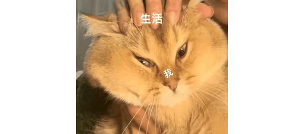

# Q 弹 GIF 制作器

把一张图片变成循环播放的 Q 弹表情包。图片底部居中固定，下压时变矮变宽，回弹时恢复原来的比例。窗口左侧即时预览，右侧可调整形变、停顿和缓冲，处理和导出都在本地完成。



## Windows 单文件版

| 项目 | 说明 |
| --- | --- |
| 文件 | `dist/BouncyMemeGenerator.exe` |
| 系统 | Windows 10 或 11，x64 |
| 体积 | 本次构建约 9.0 MiB |
| 运行方式 | 双击打开，免安装，无需 Python 或 UPX |
| 支持导入 | PNG、JPG / JPEG、WebP、BMP、GIF、TIF / TIFF |
| 导出 | 循环播放的 `.gif`，支持透明背景 |

已有打包产物时，可以只复制 EXE 到任意可写目录使用。从源码检出本项目后，可以按下面的[重新打包](#重新打包)步骤生成 EXE。

## 快速上手

1. 双击运行 `BouncyMemeGenerator.exe`。
2. 把一张图片拖到预览区，或点击「选择图片…」。双击预览区也能打开文件选择器。
3. 调整右边的参数，观察左侧的动画和右侧显示的每轮时长。
4. 在「输出文件名」里输入名称。默认是 `原文件名_Q弹.gif`。
5. 点击「导出 GIF…」，或在文件名输入框中按 Enter。保存窗口默认打开到原图所在的目录，可以更换目录或文件名。
6. 如果下次还想使用当前参数，点击「保存配置」。

PowerShell 中也可以在启动时传入一张图片，路径含空格时用引号包起来。

```powershell
.\dist\BouncyMemeGenerator.exe "C:\Pictures\我的表情.png"
```

导入动图 GIF、动态 WebP 或多页 TIFF 时，程序取第一帧或第一页作为素材，再生成一套 Q 弹动画。最适合做透明表情包的素材是四周留白较少、背景已抠掉的 PNG。

## 参数说明

| 参数 | 默认值 | 可填写范围 | 效果 |
| --- | ---: | --- | --- |
| 原高时的宽度 | 300 像素 | 16–4096，整数 | 图片在未压缩时的宽度，高度按原图比例计算 |
| 压到底的高度 | 49% | 1–100% | 压到底时的高度占恢复高度的比例，越小越扁 |
| 压到底的宽度 | 2 倍 | 1–8 倍 | 压到底时的宽度相对恢复宽度的倍数，越大越宽 |
| 下压时长 | 60 毫秒 | 20–10000 | 从恢复状态到压扁状态的时长 |
| 上弹时长 | 90 毫秒 | 20–10000 | 从压扁状态到恢复状态的时长 |
| 顶部停顿 | 160 毫秒 | 0 或 20–10000 | 图片恢复后停留的时间，填 0 跳过停顿 |
| 底部停顿 | 170 毫秒 | 0 或 20–10000 | 图片压到底后停留的时间，填 0 跳过停顿 |
| 起步加速距离 | 10% | 0–100% | 下压和上弹各自起步时用于加速的行程占比 |
| 到位减速距离 | 14% | 0–100% | 下压和上弹各自接近终点时用于减速的行程占比 |
| 每段最多过渡帧 | 3 帧 | 1–120，整数 | 分别限制下压和上弹这两段的过渡帧数量 |

- 所有时长都填 10 毫秒的倍数。默认一轮 `60 + 90 + 160 + 170 = 480` 毫秒，下压平均速度是上弹的 `1.5` 倍。
- 两个缓冲距离之和最多为 `100%`。两个都填 `0` 时，下压和上弹各自匀速变化。
- 每帧至少 `20` 毫秒。例如下压设为 `60` 毫秒，即使过渡帧上限填 `10`，下压仍最多有 `3` 帧。想让形变更细腻，可以同时增加动作时长和帧数上限。
- GIF 画布按压到底的最大宽度和恢复时的最大高度计算。例如原高时宽度为 `300` 像素、压到底宽度为 `2` 倍，导出的画布宽度就是 `600` 像素。
- GIF 的透明像素只有透明和不透明两种状态。半透明边缘会按透明度转换，复杂渐变也会受 GIF 调色板限制。

## 保存、迁移和恢复配置

- **EXE 版**初次运行使用内置的默认参数。点击「保存配置」后，EXE 同目录会生成 `q_bounce_config.json`，之后启动时会读取它。
- **源码版**读取并更新 `q_bounce_gui.py` 同目录下的 `q_bounce_config.json`。这个文件也用作重新打包时的内置默认配置。
- 要迁移已保存的参数，把 `q_bounce_config.json` 和 EXE 一起复制。要让 EXE 回到内置默认值，退出程序后将同目录下的 JSON 改名或移走，再打开 EXE。
- 可以用文本编辑器手动修改 JSON。保存为 UTF-8，保留键名和数字的 JSON 类型。如果配置报错，可以按下表所列的文件位置检查该文件。

| 文件 | 用途 |
| --- | --- |
| `q_bounce_gui.py` | 图形界面、动画预览和 GIF 导出 |
| `q_bounce_config.json` | 默认参数与源码版的配置文件 |
| `BouncyMemeGenerator.spec` | Windows x64 单文件打包配置 |
| `生活-我-Q弹.gif` | 导出效果示例，也可作为试用素材 |

## 从源码运行

以下命令在项目目录的 PowerShell 中执行。已验证的环境是 Windows x64、Python 3.11 和 Tcl/Tk 8.6。安装 Python 时保留 Tcl/Tk 和 IDLE 组件。

```powershell
python -m tkinter
python -m venv .venv
.\.venv\Scripts\python.exe -m pip install "Pillow==12.3.0" "tkinterdnd2==0.6.2"
.\.venv\Scripts\python.exe q_bounce_gui.py
```

第一条命令会打开 Tkinter 测试窗口。关闭测试窗口后继续执行其余命令。源码版可以在没有 `tkinterdnd2` 的情况下通过「选择图片…」导入。

## 重新打包

先完成上面的虚拟环境和依赖安装。要获得更小的 EXE，将 `upx.exe` 所在目录加入 `PATH`，使 `upx --version` 能运行。本次构建使用 PyInstaller 6.19.0、对应的 2026.3 版 hooks 和 UPX 5.3.0。

```powershell
.\.venv\Scripts\python.exe -m pip install "PyInstaller==6.19.0" "pyinstaller-hooks-contrib==2026.3"
$env:PYINSTALLER_CONFIG_DIR = Join-Path $PWD '.build\cache'
$env:BOUNCY_MEME_UPX = '1'
.\.venv\Scripts\python.exe -m PyInstaller --noconfirm --workpath .build\work BouncyMemeGenerator.spec
Get-Item .\dist\BouncyMemeGenerator.exe | Select-Object Name, Length
```

打包时会嵌入 `q_bounce_config.json` 和相应架构的拖放组件。生成的 EXE 保留文件选择器列出的图片格式。为减小体积，打包版省去了 AVIF 解码器，以及程序未使用的网络和字体库。示例 GIF 留在源码目录。

UPX 可选。如果没有安装 UPX，PyInstaller 会生成较大的单文件版。若要显式关闭 UPX，将 `$env:BOUNCY_MEME_UPX` 设为 `'0'`，再执行同一条 PyInstaller 命令。本机关闭 UPX 后构建约为 10.4 MiB。

## 常见问题

**拖入图片没有反应**  
先在资源管理器里选中一张图，把它拖到预览区。若界面提示拖放组件无法加载，使用「选择图片…」。源码运行时，可以检查当前 Python 环境是否安装了 `tkinterdnd2`。

**点「保存配置」后提示无法写入**  
把 EXE 放到你有写入权限的目录，再打开并保存参数。导出 GIF 时也需要对选定的保存目录有写入权限。

**启动时提示无法读取配置**  
检查 JSON 的格式、参数名和取值范围。EXE 版可以先把同目录下的 JSON 改名，再启动程序使用内置配置。源码版可以从项目中恢复默认 JSON。

**导出的 GIF 太大，或提示尺寸过大**  
先减小「原高时的宽度」或「压到底的宽度」，再降低「每段最多过渡帧」。前两个参数影响画布尺寸，帧数影响处理开销和输出体积。

**预览与 GIF 的颜色或节奏有少许差异**  
预览直接使用原图颜色。GIF 使用有限的调色板，播放器也可能以不同方式处理短帧的时长。
